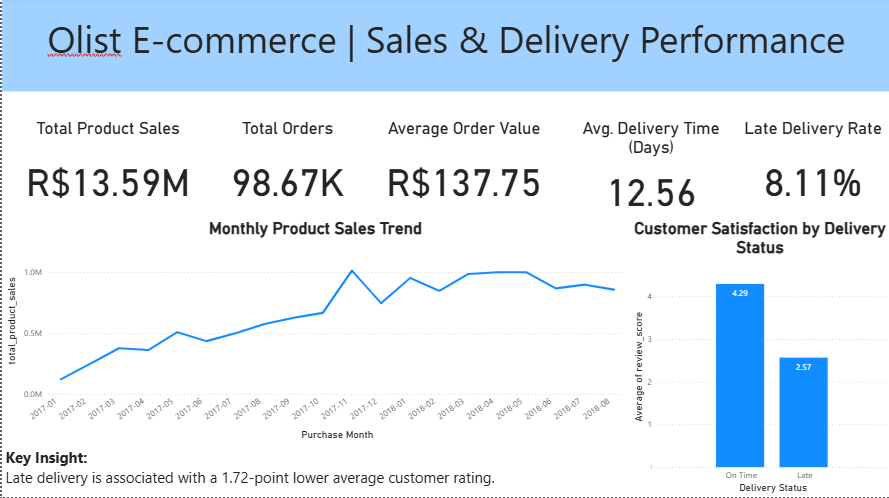

# Olist E-commerce Analytics

## Project Overview

This project analyses the Brazilian Olist e-commerce dataset to evaluate sales performance, delivery efficiency, and customer satisfaction.

The objective is to identify business trends, assess delivery performance, and explore the relationship between delivery delays and customer reviews.

## Tools Used

- **Python (Pandas):** Data exploration, cleaning, and validation
- **MySQL:** Data storage and business analysis using SQL
- **Power BI:** Interactive dashboard and KPI visualization
- **Jupyter Notebook:** Python analysis and documentation

## Business Questions

1. How did product sales and order volume change over time?
2. What was the average delivery time, and how frequently were orders delayed?
3. How did customer ratings differ between on-time and late deliveries?

## Key Findings

| Metric | Result |
|---|---|
| Total product sales | R$13.59 million |
| Orders containing items | 98,666 |
| Average Order Value | R$137.75 |
| Average delivery time | 12.56 days |
| Late delivery rate | 8.11% |
| Average rating — On Time | 4.29/5 |
| Average rating — Late | 2.57/5 |

### Business Insights

**Sales:** Sales growth was driven primarily by increasing order volume rather than higher average spending per order.

**Delivery:** Approximately 8.11% of delivered orders arrived after their estimated delivery date.

**Customer satisfaction:** Late deliveries were associated with substantially lower customer ratings, with a 1.72-point difference in average scores.

## Project Workflow

1. Imported and explored the Olist dataset using Python and Pandas.
2. Examined missing values, duplicate records, data types, and data quality.
3. Created MySQL tables and loaded the required data.
4. Used SQL joins, aggregations, date functions, and conditional logic to answer business questions.
5. Built a Power BI dashboard to visualize key metrics and trends.
6. Documented business findings and recommendations.

## Dashboard

The Power BI dashboard presents sales KPIs, monthly sales trends, delivery performance, and customer satisfaction.



Note: The Power BI dashboard screenshot is included in this repository. The interactive .pbix file is available upon request.

## Project Structure

```text
Olist_Ecommerce_Analytics/
├── notebooks/
│   └── Olist_Ecommerce_Analysis_Clean.ipynb
├── sql/
│   ├── Olist_Database_Setup.sql
│   └── Olist_Business_Analysis.sql
├── dashboard/
│   └── Olist_Ecommerce_Analytics.pbix
├── reports/
│   └── business_insights.md
├── data/
│   └── README.md
└── README.md
```

## Data Source

Olist Brazilian E-Commerce Public Dataset, available on Kaggle.

https://www.kaggle.com/datasets/olistbr/brazilian-ecommerce

## Limitations

- Product sales exclude freight and should not be interpreted as net revenue or profit.
- Incomplete boundary months are excluded from the monthly sales visualization.
- Ten review records were not included in the SQL import.
- Observed relationships between delivery performance and reviews do not establish causation.

## Conclusion

The analysis identified order-volume growth as a key contributor to sales performance and found a strong association between late deliveries and lower customer ratings.

The project demonstrates the use of Python, SQL, and Power BI to transform raw data into actionable business insights.
